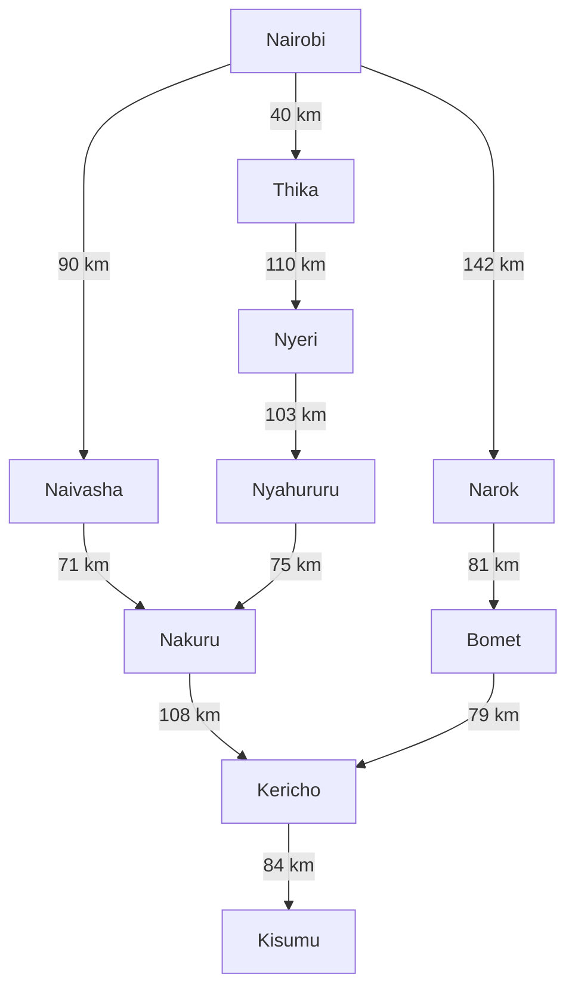
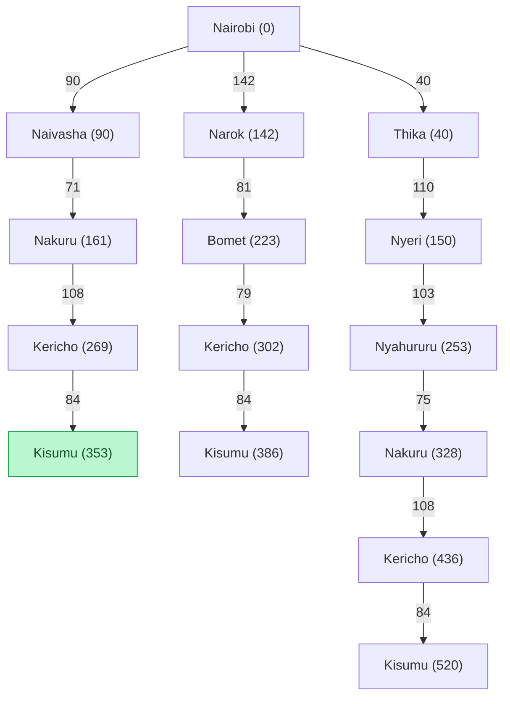

# Groupwork  Practical Exercise 3: Designing a Searching Agent

Emmanuel Onyango- 191258  
 
Rayvon Andeche - 190159  

Austin Maina - 192076

Atiq Yaasir- 190375

## 1. Self-driving trailer as an intelligent agent
### 1.1 PEAS framework
Here is a clean table with no added colours, ready to copy into Word or your Markdown file.

| PEAS Component       | Design Elements                                                                           | Why                                                                                         |
| -------------------- | ----------------------------------------------------------------------------------------- | ------------------------------------------------------------------------------------------- |
| Performance Measures | Safe arrival, shortest route distance, fuel efficiency, timely arrival                    | Success is not just reaching Kisumu; safety and fuel consumption should also be considered. |
| Environment          | Roads, traffic, pedestrians, junctions, signs, roadworks, weather, and towns on the route | The trailer operates in a changing physical road environment.                               |
| Actuators            | Steering, engine, brakes, indicators, lights, and horn                                    | They allow the agent to act on its environment.                                             |
| Sensors              | GPS, cameras, and speed sensors                                                           | These supply information about the trailer's surroundings.                                  |

Note: Markdown tables inherit their colours from the app or editor you use. If a row appears bluish, that's usually the editor's theme, not the Markdown itself.
### 1.2 Five environment classifications

| | Classification | Reasoning |
|---|---|---|
| | Partially observable | Obstacles and road conditions can be hidden or outside sensor range. |
|  | Stochastic | Other drivers, traffic and weather introduce uncertain outcomes. |
|  | Sequential | Earlier driving and routing decisions influence later states. |
|  | Dynamic | Road users and traffic conditions change during decision-making. |
|  | Multiagent| Other vehicles and road users pursue own goals and compete for the road space

## 2. Highway network: abstraction, directed graph and search tree

### 2.1 Search problem formulation

| Element | Definition |
|---|---|
| Agent | Self-driving trailer |
| Initial state | Nairobi |
| Goal test | Current town is Kisumu |
| States | Towns represented as nodes in the simplified network |
| Actions | Travel along a modelled directed road edge to the next town |
| Transition model | Move from town `u` to directly connected town `v` |
| Path cost | Sum of road distances in kilometres along the route |

### 2.2 Abstraction and assumptions

In the model, each town is a node and each road connection is a directed edge, with the driving distance as its weight (never negative). We left out bends, junctions, acceleration and steering, since they don’t affect the route search. The graph only covers the three routes our group chose to compare, not every road in Kenya. Edges point from Nairobi towards Kisumu because that’s the direction we’re searching in. The roads themselves are still two-way.

### 2.3 Distance measurements

| From | To | Distance (km) |
|---|---|---:|
| Nairobi | Naivasha | 90 |
| Naivasha | Nakuru | 71 |
| Nakuru | Kericho | 108 |
| Kericho | Kisumu | 84 |
| Nairobi | Narok | 142 |
| Narok | Bomet | 81 |
| Bomet | Kericho | 79 |
| Nairobi | Thika | 40 |
| Thika | Nyeri | 110 |
| Nyeri | Nyahururu | 103 |
| Nyahururu | Nakuru | 75 |

### 2.4 Weighted directed graph

### 2.5 Search tree of potential routes

.

## 3. Finding the optimal path

To determine the optimal path for the self-driving trailer from Nairobi to Kisumu, we evaluate the path cost function $g(n)$, defined as the total cumulative distance in km along each branch of the search tree.

### 3.1 Path Evaluation Summary

There are three main paths through the search tree:

1. **Route 1 (Rift Valley via Naivasha):**
   $$\text{Nairobi} \xrightarrow{90} \text{Naivasha} \xrightarrow{71}   \text{Nakuru} \xrightarrow{108} \text{Kericho} \xrightarrow{84} \text{Kisumu}$$
   * **Total Distance:** $90 + 71 + 84 = \mathbf{353\text{ km}}$

2. **Route 2 (Central Highlands via Thika):**
   $$\text{Nairobi} \xrightarrow{40} \text{Thika} \xrightarrow{110} \text{Nyeri} \xrightarrow{103} \text{Nyahururu} \xrightarrow{75} \text{Nakuru} \xrightarrow{108} \text{Kericho} \xrightarrow{84} \text{Kisumu}$$
   * **Total Distance:** $40 + 110 + 103 + 75 + 108 + 84 = \mathbf{520\text{ km}}$

3. **Route 3 (South Rift via Narok):**
   $$\text{Nairobi} \xrightarrow{142} \text{Narok} \xrightarrow{81} \text{Bomet} \xrightarrow{79} \text{Kericho} \xrightarrow{84} \text{Kisumu}$$
   * **Total Distance:** $142 + 81 + 79 + 84 = \mathbf{386\text{ km}}$

### 3.2 Algorithmic Proof via Dijkstra's Algorithm

Comparing three hand-picked routes only tells us which of them is shortest. To be sure no cheaper path exists in our graph, we ran Dijkstra's algorithm, which is uniform-cost search: at each step, the agent expands the town with the smallest distance travelled so far. Think of a football team building an attack from the goalkeeper's goal kick. Instead of chasing the flashiest pass, they always work from the player the ball reached most cheaply, and only lock that player in once no faster route to them could exist. Each town carries a label d(v), the best distance found so far, and a pointer p(v), where we came from, so we can retrace the winning move at the end.
#### Execution Trace Table

| Iteration | Current Node Selected $u$ | $d(u)$ (km) | Updated Neighbors ($v$) | Tentative Distance $d(v)$ Formula                                                                          | Previous Node $p(v)$ | Unvisited Set $Q$ Remaining                                                           |
|:---------:|:--------------------------|:-----------:|:------------------------|:-----------------------------------------------------------------------------------------------------------|:--------------------:|:--------------------------------------------------------------------------------------|
|   **0**   | *Initialization*          |            |                        | $d(\text{Nairobi})=0$, all others $=\infty$                                                                |        `None`        | `{Nairobi, Thika, Naivasha, Narok, Nyeri, Nakuru, Bomet, Nyahururu, Kericho, Kisumu}` |
|   **1**   | **Nairobi**               |      0      | Thika, Naivasha, Narok  | $d(\text{Thika}) = 0 + 40 = 40$ $d(\text{Naivasha}) = 0 + 90 = 90$ $d(\text{Narok}) = 0 + 142 = 142$ |       Nairobi        | `{Thika, Naivasha, Narok, Nyeri, Nakuru, Bomet, Nyahururu, Kericho, Kisumu}`          |
|   **2**   | **Thika**                 |     40      | Nyeri                   | $d(\text{Nyeri}) = 40 + 110 = 150$                                                                         |        Thika         | `{Naivasha, Narok, Nyeri, Nakuru, Bomet, Nyahururu, Kericho, Kisumu}`                 |
|   **3**   | **Naivasha**              |     90      | Nakuru                  | $d(\text{Nakuru}) = 90 + 71 = 161$                                                                         |       Naivasha       | `{Narok, Nyeri, Nakuru, Bomet, Nyahururu, Kericho, Kisumu}`                           |
|   **4**   | **Narok**                 |     142     | Bomet                   | $d(\text{Bomet}) = 142 + 81 = 223$                                                                         |        Narok         | `{Nyeri, Nakuru, Bomet, Nyahururu, Kericho, Kisumu}`                                  |
|   **5**   | **Nyeri**                 |     150     | Nyahururu               | $d(\text{Nyahururu}) = 150 + 103 = 253$                                                                    |        Nyeri         | `{Nakuru, Bomet, Nyahururu, Kericho, Kisumu}`                                         |
|   **6**   | **Nakuru**                |     161     | Kericho                 | $d(\text{Kericho}) = 161 + 108 = 269$                                                                      |        Nakuru        | `{Bomet, Nyahururu, Kericho, Kisumu}`                                                 |
|   **7**   | **Bomet**                 |     223     | Kericho                 | $223 + 79 = 302 > 269$ *(No change)*                                                                       |        Narok         | `{Nyahururu, Kericho, Kisumu}`                                                        |
|   **8**   | **Nyahururu**             |     253     | Nakuru                  | $253 + 75 = 328 > 161$ *(No change)*                                                                       |        Nyeri         | `{Kericho, Kisumu}`                                                                   |
|   **9**   | **Kericho**               |     269     | Kisumu                  | $d(\text{Kisumu}) = 269 + 84 = 353$                                                                        |       Kericho        | `{Kisumu}`                                                                            |
|  **10**   | **Kisumu (Goal)**         |   **353**   |                        | **Goal Reached**                                                                                           |       Kericho        | `{}`                                                                                  |

### 3.3 Backtracking & Final Path

Tracing backward from the destination **Kisumu** using the predecessor pointer $p(v)$:
$$\text{Kisumu} \longleftarrow \text{Kericho} \longleftarrow \text{Nakuru} \longleftarrow \text{Naivasha} \longleftarrow \text{Nairobi}$$

Optimal path:
$$\mathbf{\text{Nairobi} \longrightarrow \text{Naivasha} \longrightarrow \text{Nakuru} \longrightarrow \text{Kericho} \longrightarrow \text{Kisumu}}$$

* **Minimum Path Cost:** $\mathbf{353\text{ km}}$
* **Conclusion:** The Naivasha–Nakuru–Kericho route is optimal at 353 km. It is 33 km shorter than the Narok route (386 km) and 167 km shorter than the Thika route (520 km). This result optimises distance only. Fuel use, travel time and road conditions, which our PEAS performance measure also names, would need extra data to compare.

## group photo

