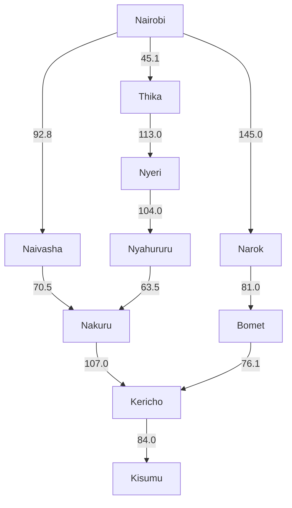
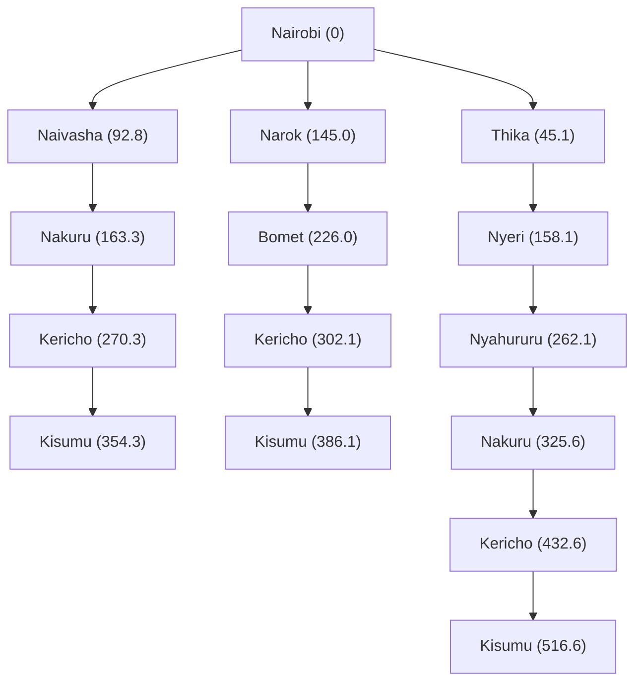

# Practical Exercise 3: Designing a Searching Agent

Emmanuel Onyango - 191258  
Rayvon Andeche - 190159  
Austin Maina - 192076  
Atiq Yaasir - 190375

## 1. Self-driving trailer agent

### PEAS framework

| Component | Description |
|---|---|
| Performance measure | Deliver the cargo safely, follow traffic rules, minimise distance and fuel use, and arrive on time. |
| Environment | Roads, towns, junctions, other vehicles, pedestrians, traffic signs, weather and roadworks. |
| Actuators | Steering, accelerator, brakes, indicators, lights and horn. |
| Sensors | GPS, cameras, radar, speed sensors and trailer load sensors. |

### Five environment classifications

| Classification | Reason |
|---|---|
| Partially observable | The sensors cannot detect everything, such as a vehicle hidden around a bend. |
| Stochastic | Other drivers and changing road conditions make outcomes uncertain. |
| Sequential | A turn or lane change affects the trailer's later position and available actions. |
| Dynamic | Traffic and pedestrians keep moving while the agent decides what to do. |
| Multiagent | The trailer shares the road with drivers and pedestrians who have their own goals. |

## 2. Directed graph and search tree

The initial state is Nairobi and the goal state is Kisumu. Each state is a town, and an action means travelling along a road link to the next town. The path cost is the sum of the distances travelled in kilometres.

We use the map in *Problem Solving Agents*, page 4. Nairobi is the starting region; Thika and Nyeri represent the Central Highlands; Naivasha, Nakuru, Nyahururu, Narok, Bomet and Kericho represent the Rift Valley; and Kisumu represents the Lake Victoria Basin.

**Abstraction:** We keep the towns and road distances, leaving out individual bends, minor junctions and driving controls. The graph compares three routes from the class map. Arrows show the travel direction being considered; they do not mean the roads are one-way. Other roads are outside this simplified model.

### Road distances

These approximate road distances were checked on Google Maps on 16 October 2026. R1-R3 show the towns used as stops. We reuse one cost for each shared road link, so rounding and town entry/exit turns may cause small differences from Google's trip totals. We assume these roads are usable by the trailer.

| From | To | Distance (km) | Source |
|---|---|---:|---|
| Nairobi | Naivasha | 92.8 | [R1](https://www.google.com/maps/dir/Nairobi/Naivasha/Nakuru/Kericho/Kisumu/) |
| Naivasha | Nakuru | 70.5 | R1 |
| Nakuru | Kericho | 107.0 | R1 |
| Kericho | Kisumu | 84.0 | R1 |
| Nairobi | Narok | 145.0 | [R2](https://www.google.com/maps/dir/Nairobi/Narok/Bomet/Kericho/Kisumu/) |
| Narok | Bomet | 81.0 | R2 |
| Bomet | Kericho | 76.1 | R2 |
| Nairobi | Thika | 45.1 | [R3](https://www.google.com/maps/dir/Nairobi/Thika/Nyeri/Nyahururu/Nakuru/Kericho/Kisumu/) |
| Thika | Nyeri | 113.0 | R3 |
| Nyeri | Nyahururu | 104.0 | R3 |
| Nyahururu | Nakuru | 63.5 | R3 |

### Directed graph

The numbers on the arrows are distances in kilometres.

### Search tree

The number in brackets total distance from Nairobi. This shows the possible routes.

## 3. Optimal path from Nairobi to Kisumu

**Path cost = sum of the road distances between consecutive towns.**

| Route | Calculation (km) | Total (km) |
|---|---|---:|
| Nairobi → Naivasha → Nakuru → Kericho → Kisumu | 92.8 + 70.5 + 107.0 + 84.0 | **354.3** |
| Nairobi → Narok → Bomet → Kericho → Kisumu | 145.0 + 81.0 + 76.1 + 84.0 | 386.1 |
| Nairobi → Thika → Nyeri → Nyahururu → Nakuru → Kericho → Kisumu | 45.1 + 113.0 + 104.0 + 63.5 + 107.0 + 84.0 | 516.6 |

We use uniform-cost search (Dijkstra's algorithm), which expands the town with the lowest accumulated distance. At Kericho, it keeps the 270.3 km path through Nakuru instead of the 302.1 km path through Bomet. It also keeps the 163.3 km path to Nakuru through Naivasha instead of the 325.6 km path through Nyahururu. The search stops when Kisumu is selected from the frontier. With positive edge costs, this gives the shortest path in the graph.

**Optimal path: Nairobi → Naivasha → Nakuru → Kericho → Kisumu.**  
**Total distance: approximately 354.3 km.**

This is the shortest route in our simplified graph. The calculation minimises distance; it does not compare journey time or fuel use.

## References

- *Intelligent Agents*, class slides, pages 15 and 20-25.
- *Problem Solving Agents*, class slides, pages 4-14.
- [Google Maps class-map view](https://www.google.com/maps/@-0.6429168,35.8398069,9z).
- Google Maps driving directions, R1-R3 in the distance table.

## Group photo

